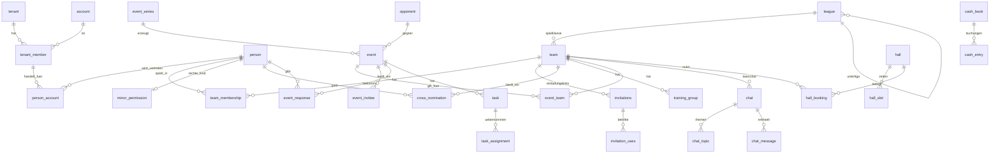

# Datenmodell – VolleyOrga

MySQL 8, InnoDB, `utf8mb4_unicode_ci` (E-Mail-Vergleiche damit automatisch ohne Groß-/Kleinschreibung). Laravel-Migrationen. Konventionen:

- Primärschlüssel `id` als **ULID** (`CHAR(26)`, zeitlich sortierbar, nicht erratbar in URLs).
- **Jede Mandantentabelle** hat `tenant_id CHAR(26) NOT NULL` und einen Unique-Index `(tenant_id, id)`. Fremdschlüssel innerhalb eines Mandanten sind **zusammengesetzt**: `(tenant_id, x_id) → x(tenant_id, id)` – InnoDB verhindert damit mandantenübergreifende Verweise. In der Anwendung filtert zusätzlich ein globaler Eloquent-Scope jede Abfrage auf den aktuellen Mandanten (MySQL hat keine Row-Level-Security).
- Zeitstempel `created_at`, `updated_at` (`DATETIME`, in UTC gespeichert); Anzeige in der Zeitzone des Mandanten.
- Geldbeträge in **Cent** (`BIGINT`), nie als Float.
- Weiche Löschung (`deleted_at`) nur wo Historie nötig ist (Personen, Termine, Buchungen).
- Aufzählungen (Enums) als `VARCHAR` + PHP-Backed-Enums (Laravel-Casts), damit neue Werte ohne Tabellenumbau möglich sind.
- Listen (z. B. Nebenpositionen) als `JSON`-Spalte oder eigene Zuordnungstabelle.
- Tabellennamen im Code im Plural (Laravel-Konvention, z. B. `events`); noch nicht umgesetzte Tabellen stehen hier zur besseren Lesbarkeit im Singular.
- Zusammengesetzte Fremdschlüssel können nicht `ON DELETE SET NULL` sein (würde auch `tenant_id` leeren); solche Verweise leert die Anwendung vor dem Löschen (`restrict`).

Legende: 🌐 = global (kein Mandant), 🏢 = mandantenbezogen.

---

## 1. Plattform, Login, Sessions

### 🌐 `tenant` – Abteilung (Dach-Account)
| Feld | Typ | Hinweis |
|---|---|---|
| id | ulid | |
| slug | text unique | URL-Pfad, z. B. `ssv-ulm-volleyball` |
| name | text | |
| logo_file_id | ulid → file | globales Abteilungslogo (Logo-Ebene 1) |
| default_locale | text | `de` |
| timezone | text | `Europe/Berlin` |
| season_start_month | smallint | z. B. 7 (= Juli) für Schnellwahl „Saison“ in der Statistik |
| mail_from_name | text | Absendername der Mails |
| status | enum `active`, `suspended` | |

### 🌐 `setting` – Installationseinstellungen
`key`, `value` (JSON). U. a. **Mail-Versand**: `mail.driver` = `sendmail` (PHP `mail()`, Standard) oder `smtp`; bei SMTP `host`, `port`, `encryption` (`tls`/`ssl`), `username`, `password` (mit App-Schlüssel verschlüsselt), `from_address`. Außerdem VAPID-Schlüssel für Web-Push und Ergebnis der letzten SSL-Selbstprüfung.

### 🌐 `account` – Login-Identität
| Feld | Typ | Hinweis |
|---|---|---|
| id | ulid | |
| email | varchar unique | einziges Login-Merkmal |
| locale | text | `de` / `en`, Standard `de` |
| is_platform_admin | bool | darf nur Mandanten verwalten |
| last_login_at | datetime | |

### 🌐 `auth_tokens` – Magic-Link
`id`, `email`, `token_hash` (`CHAR(64)`, SHA-256), `purpose` (`login` | `join`), `tenant_id`, `payload` (JSON, bei `join`: Einladung und Formulardaten), `expires_at` (+15 min), `used_at`, `requested_ip`, `user_agent`.
Einmalig einlösbar (atomares `UPDATE … WHERE used_at IS NULL`). Der Link öffnet eine Seite mit Button – erst der Klick (POST) meldet an, damit Mail-Scanner den Link nicht verbrauchen.

### 🌐 `account_sessions`
`id`, `account_id`, `token_hash`, `created_at`, `last_seen_at`, `expires_at`, `user_agent`, `ip`, `revoked_at`.
**Gleitende Laufzeit:** `expires_at = last_seen_at + 90 Tage`; bei Nutzung wird verlängert (Schreibzugriff höchstens einmal pro Tag). Cookie `__Host-vp_session` (HttpOnly, Secure, SameSite=Lax), nur der Hash liegt in der Datenbank.

### 🌐 `push_subscriptions` ✅
`id`, `account_id`, `endpoint`, `endpoint_hash` (unique), `public_key` (p256dh), `auth_token`, `user_agent`, `last_success_at`, Zeitstempel. Ein Gerät gehört dem gerade angemeldeten Login und bekommt die Nachrichten aller seiner Abteilungen. Meldet der Push-Dienst ein Gerät als abgemeldet (404/410), wird die Zeile gelöscht. Nur Endpunkte der Browser-Push-Dienste (Google, Mozilla, Apple, Microsoft) werden angenommen.

---

## 2. Mitgliedschaft, Personen, Rollen

Trennung zwischen **Account** (wer sich einloggt) und **Person** (Spielerprofil innerhalb einer Abteilung). Ein Kind ist eine Person ohne (oder mit eingeschränktem) eigenen Account; ein Elternteil ist ein Account, der mit der Person des Kindes verknüpft ist.

### 🏢 `tenant_member` – Account in einer Abteilung
| Feld | Typ | Hinweis |
|---|---|---|
| tenant_id, id | | |
| account_id | ulid → account | unique (tenant_id, account_id) |
| is_admin | bool | Rolle **Admin** |
| status | enum `active`, `disabled` | `disabled` = Zugang gesperrt (Admin) |

### 🏢 `person` – zentrales Spielerprofil
| Feld | Typ | Hinweis |
|---|---|---|
| first_name, last_name | text | |
| jersey_number | smallint null | |
| birthday | date null | optional; Alter wird daraus berechnet (nur Anzeige/Minderjährigkeit, **nicht** für Hierarchie oder Spielerauswahl – maßgeblich ist die Team-Einteilung) |
| gender | enum `male`, `female` | für Quernominierungsregel |
| phone | text null | |
| email | varchar null | Kontaktadresse (nicht zwingend = Login) |
| street, postal_code, city, country | text null | Postadresse |
| primary_position | enum `position` null | |
| secondary_positions | JSON (Liste von `position`) | |
| height_cm | smallint null | Körpergröße |
| reach_height_cm | smallint null | Reichhöhe (stehend) |
| jump_reach_cm | smallint null | Sprung-Reichhöhe (Angriff) |
| avatar_file_id | ulid → file null | |
| shared_fields | JSON | Detailfelder (`phone`, `email`, `address`, `birthday`), die die Person **allen** Mitgliedern freigibt |
| deleted_at | datetime null | |

**Sichtbarkeit:** Standardangaben (Name, Trikotnummer, Geschlecht, Positionen, Größe, Reich-/Sprunghöhe, Profilbild) sehen alle Mitglieder der Abteilung. Detailangaben (Telefon, E-Mail, Adresse, Geburtstag) nur, wenn freigegeben – oder für die Person selbst, ihre Eltern, Trainer ihrer Teams und Admins.

**Bearbeiten:** Person selbst und Eltern alles (ein Kind nur, was die Eltern erlauben); Trainer der Person nur Trikotnummer und Positionen; Admins alles.

`position` = `setter` (Zuspiel), `opposite` (Diagonal), `middle` (Mittelblock), `outside` (Außenangriff), `libero`, `universal`.

### 🏢 `person_account` – wer handelt für welche Person
| Feld | Typ | Hinweis |
|---|---|---|
| person_id | → person | |
| tenant_member_id | → tenant_member | |
| relation | enum `self`, `guardian` | `guardian` = Eltern-Account |
| ended_at | datetime null | Ende der Elternverknüpfung (automatisch zum 18. Geburtstag) |

Unique `(person_id, tenant_member_id)`. Ein Account hat höchstens eine `self`-Person pro Abteilung, kann aber mehrere Kinder (`guardian`) haben. Die Startseite zeigt Termine aller verknüpften Personen.

### 🏢 `minor_permission` – was das Kind selbst darf (von den Eltern festgelegt)
| Feld | Typ | Hinweis |
|---|---|---|
| person_id | → person (unique) | das minderjährige Kind |
| own_login | bool | Kind darf einen eigenen Account (`relation = self`) haben |
| can_rsvp | bool | eigene Zu-/Absagen |
| can_chat | bool | Chat lesen/schreiben |
| can_take_tasks | bool | Aufgaben/Helferdienste übernehmen |
| can_vote_polls | bool | an Umfragen teilnehmen |
| editable_profile_fields | JSON | Liste der Profilfelder, die das Kind selbst ändern darf (z. B. `["avatar","phone"]`) |
| updated_by | → tenant_member | Elternteil |

Regeln:
- Eine Person gilt als minderjährig, solange eine aktive `guardian`-Verknüpfung besteht; dafür ist das Geburtsdatum Pflicht.
- Ohne Freigabe in `minor_permission` darf nur das Elternteil handeln; die Eltern haben immer die alleinige Entscheidung über das Profil.
- **Zum 18. Geburtstag** setzt ein täglicher Job (`app:release-adults`) `ended_at` an allen `guardian`-Verknüpfungen und löscht `minor_permission`; ab dann verwaltet die Person ihr Profil allein. Hat sie noch keinen eigenen Login, lädt sie ein Trainer/Admin per Personen-Link ein. Eltern und Person bekommen dazu eine E-Mail.

### 🏢 `referee_licenses` – Schiedsrichter-Lizenz ✅
`person_id` (unique), `level` (text, z. B. „D“, „C“, „BK“), `license_number` null, `valid_until` date. Eintragen: die Person selbst (bei Kindern die Eltern) und Admins. Sichtbar für alle, die die Profildetails sehen (Person, Eltern, Trainer ihrer Teams, Admins) – im Kader als Hinweis „SR D bis …“, gelb ab 60 Tage vor Ablauf, rot wenn abgelaufen.

---

## 3. Ligabaum, Teams, Hierarchie

### 🏢 `leagues` – admin-pflegbarer Ligabaum ✅
| Feld | Typ | Hinweis |
|---|---|---|
| parent_id | → league null | Baumstruktur (z. B. Verband → Ebene → Staffel) |
| name | text | „1. Bundesliga“, „Regionalliga Süd“, „Bezirksklasse“ … |
| level | smallint | 1 = höchste Spielklasse; daraus Hierarchie-Rang |
| sort_order | int | |

Vorlage: Beim ersten Aufruf wird der Standard-Ligabaum angelegt (1. Bundesliga, 2. Bundesliga, 3. Liga, Regionalliga, Oberliga, Verbandsliga, Landesliga, Bezirksliga, Bezirksklasse, Kreisliga, Kreisklasse – Ebene 1 … 11), danach frei anpassbar. Unterligen (z. B. „Regionalliga Süd“) übernehmen die Ebene der übergeordneten Liga, wenn nichts anderes eingetragen ist. Löschen nur ohne Unterligen und ohne (aktive) Teams.

### 🏢 `team`
| Feld | Typ | Hinweis |
|---|---|---|
| name | text | „Herren 1“, „U18 männlich“ |
| import_name | text null | ✅ Name des Teams in Spielplan-Dateien des Verbands (z. B. „SSV Ulm 1846 2“), beim Import gemerkt |
| gender | enum `men`, `women`, `mixed` | Geschlechtsart |
| is_youth | bool | Jugendteam (U12 … U20): von Hierarchie, Quernominierung und Spielerauswahl ausgenommen |
| league_id | → leagues null | ✅ Liga aus dem Ligabaum |
| rank_in_league | smallint | Reihenfolge, falls zwei eigene Teams in gleicher Liga |
| logo_file_id | → file null | Logo-Ebene 2 |
| min_participants | smallint null | Mindestteilnehmerzahl Training (global pro Team) |
| default_max_participants | smallint null | Vorgabe für neue Trainings |
| cross_nomination_mode | enum `immediately`, `hours_before_start`, `after_rsvp_deadline` | **Team-Einstellung (Trainer):** ab wann Quernominierte standardmäßig zusagen dürfen |
| cross_nomination_hours | smallint null | bei `hours_before_start`, z. B. 24 |
| decline_reason_required | bool | **Team-Einstellung (Trainer):** Absagegrund ist Pflicht (gilt für `no`; optional auch für `maybe`) |
| maybe_reason_required | bool | Begründung auch bei „Vielleicht“ Pflicht |
| reasons_visible_to_teammates | bool | Mitspieler sehen Absagegründe; Trainer/Admin sehen sie immer |
| rsvp_visibility | enum `names`, `counts` | **Team-Einstellung (Trainer):** Mitspieler sehen, wer zu-/abgesagt hat, oder nur die Anzahl |
| color | text | Akzentfarbe in der UI |
| archived_at | datetime null | |

Hierarchie-Rang (berechnet, nur Teams mit `is_youth = false` und Liga): `(league.level, team.rank_in_league)` – kleinerer Wert = höheres Team. Teams ohne Liga stehen außerhalb der Hierarchie.

**Regel „höheres Team spielt nicht im niedrigeren“:** Spieler eines höheren Teams dürfen auch im Kader eines niedrigeren Teams **derselben Art** (Herren/Damen/Mixed) stehen und dort **mittrainieren**, werden aber zu dessen **Spieltagen nicht eingeladen** (und können dort nicht zusagen). Der Kader zeigt dazu „Spielt in … – trainiert hier mit, aber keine Spieltage“. Ändert sich die Rangfolge (Liga, Rang, Art) oder der Kader, werden die Einladungen aller kommenden Termine neu abgeglichen. Trainer-/Betreuerrollen sind nicht betroffen; Mixed-Teams zählen als eigene Art.

### 🏢 `team_membership`
| Feld | Typ | Hinweis |
|---|---|---|
| team_id | → team | |
| person_id | → person | |
| role | enum `player`, `trainer`, `organizer` | eine Zeile pro Rolle |
| joined_at | date | |

Unique `(team_id, person_id, role)`. Ein Spieler (auch Erwachsene) kann so mehreren Teams angehören; ein Trainer mehrere Teams betreuen. **Jeder Trainer** (und jeder Admin) kann Personen der ganzen Abteilung direkt in sein Team holen (Suche nach Namen) – sie erscheinen sofort im Team, ohne Einladung oder Bestätigung.

### 🏢 `invitations` – Einladungslinks
| Feld | Typ | Hinweis |
|---|---|---|
| kind | enum `team`, `person` | `team` = teilbarer Link zu einem Team; `person` = Einmal-Link für ein vorhandenes Profil |
| team_id | → team null | bei `team` |
| role | enum `player`, `trainer`, `organizer` null | Rolle im Team nach Beitritt (bei `team`) |
| person_id | → person null | bei `person`: das Profil, z. B. ein Kind |
| relation | enum `self`, `guardian` null | bei `person`: eigener Login bzw. Elternteil |
| token_hash | char(64) | Link `/<slug>/join/<token>`; Suche nur über den Hash |
| token_encrypted | text | mit dem App-Schlüssel verschlüsselt, damit Trainer den Link erneut anzeigen/kopieren können |
| max_uses | smallint null | null = unbegrenzt; Personen-Links: 1 |
| use_count | smallint | |
| expires_at | datetime null | Personen-Links: 14 Tage |
| revoked_at | datetime null | |
| created_by | → tenant_member null | |

- **Team-Links** erstellen Trainer, Betreuer (nur für Spieler) und Admins. Beitritt: *selbst* (eigenes Profil, wird bei Bedarf angelegt) oder bei Spieler-Links *Kind anmelden* (Eltern legen ein Kinderprofil an und werden verknüpft).
- **Personen-Links:** Eltern einladen (Trainer der Person, Admins, das erste Elternteil) oder eigenen Login einrichten (bei Kindern nur die Eltern – das setzt `own_login`; bei Erwachsenen Trainer/Admins).
- Ohne Login wird die E-Mail-Adresse per Magic Link bestätigt; erst dann entstehen Konto und Mitgliedschaft. Wer den Link nutzt, ist **sofort Mitglied** (keine Freigabe). Beitritte zählen unter Zeilensperre, damit `max_uses` auch bei gleichzeitigen Beitritten hält.

### 🏢 `invitation_uses` – Protokoll der Beitritte
`invitation_id`, `tenant_member_id`, `person_id`, `created_at` – wer ist über welchen Link beigetreten.

### 🏢 `cross_nominations` – Quernominierung (dauerhaft) ✅
| Feld | Typ | Hinweis |
|---|---|---|
| host_team_id | → team | Team, zu dessen Trainings eingeladen wird |
| person_id | → person | |
| home_team_id | → team | Stammteam (für Prüfung „nur von unten nach oben“) |
| active | bool | pro Spieler aktivierbar |
| invited_by | → tenant_member | |

Prüfung beim Anlegen (Server): Host- und Stammteam sind keine Jugendteams, Rang(host) höher als Rang(home) (über alle Teamarten hinweg, die Ligaebenen sind vergleichbar), die Person ist Spieler im Stammteam und noch nicht im Host-Team, Geschlechtsregel erfüllt (`men` ↔ `male`, `women` ↔ `female`, `mixed` ↔ beide). Unique (`host_team_id`, `person_id`); `active` schaltet pro Spieler an/aus.

Gäste werden zu allen kommenden **Team-Trainings** des Host-Teams eingeladen (`event_invitees.source = cross_nomination`), nicht zu Spielen, Zusatzterminen oder Gruppentrainings. Ab wann sie zusagen dürfen, regelt `team.cross_nomination_mode` (sofort / X Stunden vor Beginn / ab Rückmeldefrist), im Termin überschreibbar über `event.cross_nomination_opens_at`. Absagen dürfen Gäste jederzeit. Liegt die Freigabe auf oder nach der Rückmeldefrist, können Gäste bis Trainingsbeginn zusagen (sie füllen freie Plätze auf). Keine Warteliste; das Teilnehmermaximum gilt für alle.

### 🏢 `training_groups` / `training_group_members` ✅
`training_groups`: `team_id`, `name` (z. B. „Zuspielertraining“). `training_group_members`: `training_group_id`, `person_id` (unique je Gruppe; nur Personen aus dem Team).
Trainings mit `training_group_id` laden nur die Gruppe ein (`source = group`) plus Trainer und Betreuer des Teams. Wird eine Gruppe gelöscht, werden ihre Trainings wieder Trainings des ganzen Teams.

---

## 4. Termine & Zu-/Absagen

### 🏢 `event_series` – Serientermin (Training) ✅
`team_id`, `title`, `description`, `weekdays` (JSON, ISO 1 = Mo … 7 = So), `interval_weeks` (1 = jede Woche, 2 = 14-tägig), `starts_on`, `ends_on` null, `start_time`, `end_time` (Ortszeit der Abteilung), `location_name`, `address`, `rsvp_deadline_minutes` (vor Beginn), `max_participants`, `generated_until`, `created_by`. `training_group_id` null ✅ *(Später: `hall_booking_id`.)*
Ein täglicher Job (`app:generate-series`) erzeugt daraus Einzeltermine rollierend ~6 Monate voraus; 19:30 bleibt über die Zeitumstellung 19:30. Serie ändern wirkt auf kommende, nicht einzeln bearbeitete Termine (`series_exception`); nicht mehr passende Termine werden abgesagt, nicht gelöscht. Serie beenden sagt alle kommenden Termine ab.

### 🏢 `opponents` – wiederverwendbare Gegner ✅
`name`, `logo_file_id` null. Logo-Ebene 3 (pro Gegner, am Spieltag ausgewählt bzw. neu hochgeladen).

### 🏢 `events` ✅
| Feld | Typ | Hinweis |
|---|---|---|
| type | enum `training`, `match`, `extra`, `helper` | Training / Spieltag (Pokal-Icon) / Zusatztermin / Helferdienst (Phase 7) |
| response_mode | enum `rsvp`, `info` | `info` = reine Informationsnotiz ohne Rückmeldung |
| title | text | |
| description | text null | |
| starts_at, ends_at | datetime | |
| meet_at | datetime null | Treffpunkt-Zeit |
| location_name, address | text null | Adresse → Google-Maps-Link |
| rsvp_deadline | datetime null | Frist |
| max_participants | smallint null | Teilnehmermaximum |
| cross_nomination_opens_at | datetime null | ✅ Override: ab wann Quernominierte zusagen dürfen; null = Team-Standard |
| series_id | → event_series null | |
| series_exception | bool | Einzeltermin wurde abweichend bearbeitet |
| training_group_id | → training_groups null | ✅ nur Trainings eines Teams |
| opponent_id | → opponent null | nur `match` |
| import_key | text null | ✅ Herkunft eines importierten Spiels (UID aus .ics bzw. Spielnummer aus CSV); unique je Team, damit ein erneuter Import aktualisiert statt doppelt anlegt |
| is_home | bool null | Heim-/Auswärtsspiel |
| scope | enum `team`, `tenant` | `tenant` = vom Admin für alle Teams |
| status | enum `scheduled`, `cancelled` | |
| created_by | → tenant_member | |

### 🏢 `event_teams` – zu welchen Teams gehört der Termin ✅
`event_id`, `team_id`. Bei `scope = tenant` werden alle (aktiven) Teams eingetragen; ein Termin kann damit auch mehreren ausgewählten Teams gehören.

### 🏢 `event_invitees` – eingeladene Personen (materialisiert) ✅
`event_id`, `person_id`, `source` enum `team`, `group`, `cross_nomination` (später `manual`).
Eingeladen sind alle Personen der Termin-Teams (Spieler, Trainer, Betreuer). Kaderänderungen aktualisieren automatisch alle kommenden Termine des Teams; vergangene bleiben unverändert (Statistik). Basis für Statistik („war eingeladen“) und Startseite.

### Positions-Soll ✅
`events.position_limits` und `event_series.position_limits` (JSON, z. B. `{"setter": 2, "libero": 1}`; null = ohne). Die Reihe gibt ihre Werte an neu erzeugte Termine weiter.

### 🏢 `event_responses` – aktuelle Zu-/Absage ✅
| Feld | Typ | Hinweis |
|---|---|---|
| event_id, person_id | | unique |
| status | enum `yes`, `no`, `maybe` | Zusage / Absage / Vielleicht (zählt nicht als Zusage für Limit und Mindestteilnehmer) |
| as_position | enum `position` null | Position, für die zugesagt wurde (Positions-Soll) ✅ |
| reason | text null | Absage-/Vielleicht-Grund; Pflicht laut Team-Einstellung, Sichtbarkeit für Mitspieler laut `team.reasons_visible_to_teammates` |
| responded_by | → tenant_member | wer geklickt hat (Spieler selbst oder Elternteil) |
| responded_at | datetime | |

### 🏢 `event_response_logs` – Historie „wer wann“ ✅
Append-only: `event_id`, `person_id`, `old_status`, `new_status`, `responded_by`, `created_at`, `after_deadline` bool.

**Rückmelde-Regeln:** nur Eingeladene und Termine mit `response_mode = rsvp`; bis zur Frist (ohne Frist: bis Beginn) – Trainer, Betreuer und Admins können danach noch eintragen; Grund Pflicht laut Team-Einstellung (bei mehreren Teams gilt die strengere); Eltern antworten für ihre Kinder, Kinder selbst nur mit `can_rsvp`.

**Sichtbarkeit:** Trainer, Betreuer, Admins sehen immer Namen; Mitspieler Namen oder nur Anzahl laut `team.rsvp_visibility` (mehrere Teams: strenger). Gründe sehen Trainer/Admins immer, andere nur, wenn alle Teams sie freigeben.

**Mindestteilnehmer:** Trainings mit weniger Zusagen als `team.min_participants` werden gelb markiert.

**Positionen:** Wer den Termin verwaltet, sieht die Zusagen der Spieler nach Hauptposition gezählt (z. B. „Zuspiel: 2, Mittelblock: 3“). Gäste sind in der Rückmeldeliste als „Gast“ markiert. Positions-Soll mit automatischem Stopp: siehe oben; gezählt wird nach `as_position`.

**Kapazitätsprüfung:** Zusage läuft in einer Transaktion mit `SELECT … FROM event WHERE id = ? FOR UPDATE`, prüft Frist und (bei Quernominierten) Freigabezeitpunkt, zählt `yes`-Antworten (gesamt und je `as_position`) und lehnt bei vollem Limit ab. Keine Warteliste – bei einer Absage wird der Platz einfach wieder frei.

---

## 5. Aufgaben & Helferdienste

### 🏢 `tasks` – Aufgabe zu einem Termin ✅
`event_id`, `title` („Fahrer“, „Kuchen mitbringen“), `description`, `slots` smallint (benötigte Anzahl), `sort_order`.

### 🏢 `task_assignments` ✅
`task_id`, `person_id`, `assigned_by`, `created_at`. Unique `(task_id, person_id)`.
Helferdienste = `event.type = helper` (`response_mode = info`) mit Aufgaben → Helfer-Statistik aus `task_assignments` (Anzahl übernommener Aufgaben pro Person und Zeitraum, Helferdienste und sonstige getrennt).

---

## 6. Umfragen

### 🏢 `polls` ✅
`title`, `description`, `scope` enum `team`, `tenant`, `multiple_choice` bool, `anonymous` bool, `allow_free_text` bool, `closes_at` null (Ende; „jetzt beenden“ setzt es), `created_by`.

### 🏢 `poll_teams` ✅ – `poll_id`, `team_id` (bei `scope = tenant` alle Teams)
### 🏢 `poll_options` ✅ – `poll_id`, `label`, `sort_order`
### 🏢 `poll_votes` ✅ – `poll_id`, `option_id` null, `person_id`, `voted_by`, `free_text` null – eine Zeile je gewählter Option, eine Textantwort ist eine Zeile ohne Option; eine neue Stimme ersetzt alle Zeilen der Person.

---

## 7. Infobereich

### 🏢 `notices` ✅
`scope` enum `team`, `tenant`, `team_id` null, `title`, `body`, `visible_from`, `visible_until`, `notified_at`, `created_by`.
`notified_at`: wann die Info gemeldet wurde – gemeldet wird, sobald sie sichtbar wird (auch bei vorausgeplanten Infos).
Trainer: `scope = team` für eigene Teams; Admin: zusätzlich `tenant`.

---

## 8. Kasse

### 🏢 `cash_books` ✅
`kind` enum `team`, `department`, `team_id` null, `book_key` (Team-ID bzw. `department`; unique je Mandant – genau eine Kasse je Team und eine Abteilungskasse, angelegt beim ersten Aufruf), `opening_balance_cents`.

### 🏢 `cash_entries` ✅
| Feld | Typ | Hinweis |
|---|---|---|
| cash_book_id | → cash_books | |
| booked_on | date | |
| amount_cents | bigint | positiv = Einnahme, negativ = Ausgabe |
| category | string null | z. B. „Mitgliedsbeitrag“, „Strafe“, „Material“ |
| description | string | |
| person_id | → persons null | optional: betroffene Person |
| created_by | → tenant_members | |
| cancelled_at, cancelled_by | datetime / → tenant_members null | Storno statt Ändern/Löschen; zählt dann nicht mehr |

Admin-Gesamtübersicht = Aggregation über alle `cash_book` des Mandanten. Keine Zahlungsabwicklung.

---

## 9. Chat

### 🏢 `chats` ✅
`kind` enum `team`, `custom`, `team_id` null (bei `team` automatisch angelegt; unique), `name` (nur `custom`), `mode` enum `flat`, `topics`, `created_by`.

### 🏢 `chat_members` ✅ – nur für `custom`-Chats (Teamchat leitet Mitglieder aus `team_membership` + Eltern ab)
`chat_id`, `tenant_member_id`, `role` enum `member`, `moderator`.

### 🏢 `chat_topics` ✅ – Unterkanäle (Telegram-Stil)
`chat_id`, `name`, `sort_order`, `archived_at`. Bei `mode = topics` gibt es ein Standard-Thema „Allgemein“.

### 🏢 `chat_messages` ✅
`chat_id`, `topic_id` null, `author_id` → tenant_member (Eltern schreiben als sie selbst; die Anzeige ergänzt den Namen des Kindes), `body` text (leer, wenn gelöscht), `reply_to_id` null, `edited_at`, `deleted_at`, `created_at`. Index `(chat_id, topic_id, id)` – Polling lädt „alle Nachrichten nach ID x“ (ULIDs sind zeitlich sortiert).

### 🏢 `chat_attachments` ✅ – `chat_id`, `message_id` null (null = hochgeladen, noch nicht gesendet), `file_id` → files (`purpose = chat_attachment`), `kind` enum `image`, `video`, `file`, `name` (Originalname), `uploaded_by`, `created_at`
### 🏢 `chat_read_states` ✅ – `chat_id`, `tenant_member_id`, `topic_key` ('' ohne Themen, sonst Themen-ID), `last_read_message_id`, `last_seen_at` (wer den Chat gerade offen hat, bekommt keinen Push); unique (`chat_id`, `tenant_member_id`, `topic_key`)

---

## 10. Hallen & Belegungsplan

### 🏢 `halls` ✅
`name`, `address`, `courts` smallint (Anzahl Hallenteile), `contact_name`, `contact_phone`, `contact_email` (Ansprechpartner, z. B. Hausmeister), `notes`.

### 🏢 `hall_slots` ✅ – verfügbare Zeiten der Halle
`hall_id`, `weekday` smallint (1–7), `start_time` time, `end_time` time, `courts` JSON null (verfügbare Hallenteile, z. B. `[1, 2]`, wenn Teil 3 eine andere Sportart nutzt; null = ganze Halle), `valid_from`, `valid_until` date null (z. B. Schulferien ausschließen).

### 🏢 `hall_bookings` ✅ – Team-Zuordnung
`hall_id`, `team_id`, `weekday`, `start_time`, `end_time`, `courts` JSON null (Liste der Hallenteile, z. B. `[1, 2]`; null = ganze Halle), `valid_from`, `valid_until`, `notes`.
Konfliktwarnung: Abfrage auf Überschneidung gleicher `hall_id`/`weekday` mit gemeinsamem Hallenteil mit überlappendem Zeit- und Gültigkeitsintervall. Kein harter Constraint, da laut Spezifikation nur gewarnt wird. Zusätzlich Warnung, wenn eine Belegung nicht in einer verfügbaren Zeit mit den passenden Hallenteilen liegt. *(Später: Serientermine aus einer `hall_booking` erzeugen.)*

Rechte: lesen = alle Mitglieder der Abteilung, schreiben = nur Admin.

---

## 11. Dateien, Benachrichtigungen, Kalender

### 🏢 `file`
`storage_key`, `mime_type`, `size_bytes`, `width`, `height`, `purpose` enum `avatar`, `team_logo`, `tenant_logo`, `opponent_logo`, `chat_attachment`, `uploaded_by`. Bilder werden serverseitig auf max. 512 px (Logos/Avatare) skaliert und als WebP gespeichert. Ablage unter `storage/app/tenants/<tenant_id>/…` außerhalb des Document Root, Auslieferung über PHP mit Rechteprüfung. (Das Mandantenlogo liegt ebenfalls hier, `tenant.logo_file_id` verweist darauf.)

### 🌐 `jobs` / `failed_jobs`
Laravel-Warteschlange (Treiber `database`) für Mails, Push und Erinnerungen; abgearbeitet per Cron.

### 🏢 `notification_preferences` ✅
`tenant_member_id`, `category` enum `event_new`, `event_changed`, `reminder`, `notice`, `poll`, `chat` (später `task`), `push` bool, `email` bool; unique (`tenant_member_id`, `category`).
Gespeichert werden nur Abweichungen vom Standard: Push für alles an, E-Mail nur bei `event_changed` (Änderungen und Absagen).

**Wer bekommt was:** Benachrichtigt werden die Logins hinter den eingeladenen Personen – der eigene Login (bei Kindern nur mit Freigabe „eigener Login“) und die Eltern; jeder Login einmal, in seiner Sprache. Wer die Änderung gemacht hat, bekommt keine Nachricht. Vergangene Termine bleiben stumm.
- Neuer Termin; eine neue Trainingsreihe nur einmal (nicht je Termin).
- Änderung von Zeit, Treffpunkt oder Ort; Absage; „findet doch statt“; Reihe geändert oder beendet (je eine Nachricht).
- Erinnerung einmalig 24 h vor der Frist (ohne Frist: vor Beginn) an alle ohne Antwort; nicht bei Terminen, die erst innerhalb dieser 24 h angelegt wurden (`events.reminder_sent_at`).
- Erinnerung einmalig 24 h vor Beginn an alle, die eine Aufgabe übernommen haben (`events.task_reminder_sent_at`).
- Neue Info, sobald sie sichtbar wird.
- Ohne Einstellungsmöglichkeit per E-Mail: Ablösung mit 18 (an Eltern und Person), fehlgeschlagene SSL-Prüfung (an alle Admins).

### 🏢 `calendar_feeds` ✅
`tenant_member_id`, `token_hash`, `created_at`, `revoked_at` – ICS-Abo-URL ohne Login.

### 🏢 `audit_log`
`actor_id`, `action`, `entity`, `entity_id`, `data` JSON, `created_at` – für Rollenänderungen, Kassenbuchungen, Elternverknüpfungen.

---

## 12. ER-Übersicht (Kern)

## 13. Wichtige Abfragen / Indizes

| Zweck | Index |
|---|---|
| Startseite (Infinite Scroll) | `event_invitee(tenant_id, person_id)`, `event(tenant_id, starts_at, id)` – Cursor `(starts_at, id) > ($cursor)` |
| Zusagen zählen | `event_response(event_id, status)` |
| Statistik je Team & Zeitraum | `event_team(team_id, event_id)` + `event(starts_at)`; Aggregation über `event_invitee` ⟕ `event_response` |
| Chat-Verlauf / Polling | `chat_message(chat_id, topic_id, id)` |
| Hallenkonflikt | `hall_booking(hall_id, weekday)` |
| Login | `auth_token(token_hash)`, `session(token_hash)` |
| Einladungslink | `invitations(token_hash)` |

---

## Ergänzungen 10/2026

- `events` / `event_series`: `min_participants` smallint null (Trainingsminimum je Termin), `guests_allowed` bool (Quernominierte dürfen zusagen; gleiche Frist wie alle).
- `invitations`: `kind = department` (Einladung in den Verein ohne Team), `grants_admin` bool.
- 🏢 `activity_log` ✅: `actor_id` (Mitglied, null = System), `action` (`created`/`updated`/`deleted`), `subject_type`, `subject_id`, `label`, `created_at`; Einträge älter als 7 Tage löscht der Cron.
- `events` / `event_series`: `guests_positions_only` bool (Gäste nur für fehlende Positionen).
- `teams`: `ideal_positions` JSON null (Idealkader: Position → Anzahl, 0 = keine).
- `halls`: `street` (120), `house_number` (20), `postal_code` (10), `city` (80), alle optional; `address` wird beim Speichern daraus zusammengesetzt.
- Konto löschen: `accounts.email` wird zu `deleted-<id>@invalid`, Sitzungen, Push-Abos und Anmeldelinks werden gelöscht, `tenant_members.status = disabled`.
- 🏢 `rsvp_rules` ✅ (Daueranworten): `person_id`, `team_id` null, `series_id` null, `event_type` null, `weekdays` JSON null (1 = Montag), `status`, `reason`, `created_by` (Mitglied).
- `event_invitees`: `attended` bool null (null = nicht erfasst, dann zählt eine Zusage); `events`: `attendance_recorded_at`.
- 🏢 `documents` ✅: `team_id` null (null = für alle), `folder` (80) null, `title` (160), `description` null, `file_id` (→ `files`, `purpose = document`), `name` (Dateiname), `uploaded_by` (Mitglied), Zeitstempel.
