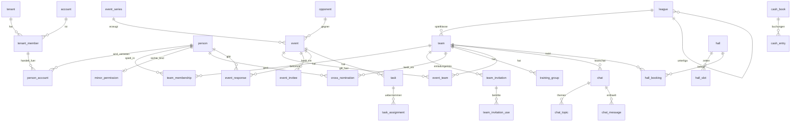

# Datenmodell – Volleyball Plus

MySQL 8, InnoDB, `utf8mb4_unicode_ci` (E-Mail-Vergleiche damit automatisch ohne Groß-/Kleinschreibung). Laravel-Migrationen. Konventionen:

- Primärschlüssel `id` als **ULID** (`CHAR(26)`, zeitlich sortierbar, nicht erratbar in URLs).
- **Jede Mandantentabelle** hat `tenant_id CHAR(26) NOT NULL` und einen Unique-Index `(tenant_id, id)`. Fremdschlüssel innerhalb eines Mandanten sind **zusammengesetzt**: `(tenant_id, x_id) → x(tenant_id, id)` – InnoDB verhindert damit mandantenübergreifende Verweise. In der Anwendung filtert zusätzlich ein globaler Eloquent-Scope jede Abfrage auf den aktuellen Mandanten (MySQL hat keine Row-Level-Security).
- Zeitstempel `created_at`, `updated_at` (`DATETIME`, in UTC gespeichert); Anzeige in der Zeitzone des Mandanten.
- Geldbeträge in **Cent** (`BIGINT`), nie als Float.
- Weiche Löschung (`deleted_at`) nur wo Historie nötig ist (Personen, Termine, Buchungen).
- Aufzählungen (Enums) als `VARCHAR` + PHP-Backed-Enums (Laravel-Casts), damit neue Werte ohne Tabellenumbau möglich sind.
- Listen (z. B. Nebenpositionen) als `JSON`-Spalte oder eigene Zuordnungstabelle.
- Tabellennamen im Code im Plural (Laravel-Konvention, z. B. `events`); hier zur besseren Lesbarkeit im Singular.

Legende: 🌐 = global (kein Mandant), 🏢 = mandantenbezogen.

---

## 1. Plattform, Login, Sessions

### 🌐 `tenant` – Abteilung (Dach-Account)
| Feld | Typ | Hinweis |
|---|---|---|
| id | ulid | |
| slug | text unique | URL-Pfad, z. B. `ssv-ulm-volleyball` |
| name | text | |
| logo_file_id | ulid → file | globales Abteilungslogo (Logo-Ebene 1) |
| default_locale | text | `de` |
| timezone | text | `Europe/Berlin` |
| season_start_month | smallint | z. B. 7 (= Juli) für Schnellwahl „Saison“ in der Statistik |
| mail_from_name | text | Absendername der Mails |
| status | enum `active`, `suspended` | |

### 🌐 `setting` – Installationseinstellungen
`key`, `value` (JSON). U. a. **Mail-Versand**: `mail.driver` = `sendmail` (PHP `mail()`, Standard) oder `smtp`; bei SMTP `host`, `port`, `encryption` (`tls`/`ssl`), `username`, `password` (mit App-Schlüssel verschlüsselt), `from_address`. Außerdem VAPID-Schlüssel für Web-Push und Ergebnis der letzten SSL-Selbstprüfung.

### 🌐 `account` – Login-Identität
| Feld | Typ | Hinweis |
|---|---|---|
| id | ulid | |
| email | varchar unique | einziges Login-Merkmal |
| locale | text | `de` / `en`, Standard `de` |
| is_platform_admin | bool | darf nur Mandanten verwalten |
| last_login_at | datetime | |

### 🌐 `auth_token` – Magic-Link
`id`, `email`, `token_hash` (`CHAR(64)`, SHA-256), `expires_at` (+15 min), `used_at`, `requested_ip`, `user_agent`, `redirect_to` (z. B. zurück zum Einladungslink).

### 🌐 `session`
`id`, `account_id`, `token_hash`, `created_at`, `last_seen_at`, `expires_at`, `user_agent`, `revoked_at`.
**Gleitende Laufzeit:** `expires_at = last_seen_at + 90 Tage`; bei Nutzung wird verlängert (Schreibzugriff höchstens einmal pro Tag).

### 🌐 `push_subscription`
`id`, `account_id`, `endpoint` (unique), `p256dh`, `auth`, `user_agent`, `created_at`, `last_success_at`.

---

## 2. Mitgliedschaft, Personen, Rollen

Trennung zwischen **Account** (wer sich einloggt) und **Person** (Spielerprofil innerhalb einer Abteilung). Ein Kind ist eine Person ohne (oder mit eingeschränktem) eigenen Account; ein Elternteil ist ein Account, der mit der Person des Kindes verknüpft ist.

### 🏢 `tenant_member` – Account in einer Abteilung
| Feld | Typ | Hinweis |
|---|---|---|
| tenant_id, id | | |
| account_id | ulid → account | unique (tenant_id, account_id) |
| is_admin | bool | Rolle **Admin** |
| status | enum `invited`, `active`, `disabled` | |

### 🏢 `person` – zentrales Spielerprofil
| Feld | Typ | Hinweis |
|---|---|---|
| first_name, last_name | text | |
| jersey_number | smallint null | |
| birthday | date null | optional; Alter wird daraus berechnet (nur Anzeige/Minderjährigkeit, **nicht** für Hierarchie oder Spielerauswahl – maßgeblich ist die Team-Einteilung) |
| gender | enum `male`, `female` | für Quernominierungsregel |
| phone | text null | |
| email | varchar null | Kontaktadresse (nicht zwingend = Login) |
| street, postal_code, city, country | text null | Postadresse |
| primary_position | enum `position` null | |
| secondary_positions | JSON (Liste von `position`) | |
| height_cm | smallint null | Körpergröße |
| reach_height_cm | smallint null | Reichhöhe (stehend) |
| jump_reach_cm | smallint null | Sprung-Reichhöhe (Angriff) |
| avatar_file_id | ulid → file null | |
| deleted_at | datetime null | |

`position` = `setter` (Zuspiel), `opposite` (Diagonal), `middle` (Mittelblock), `outside` (Außenangriff), `libero`, `universal`.

### 🏢 `person_account` – wer handelt für welche Person
| Feld | Typ | Hinweis |
|---|---|---|
| person_id | → person | |
| tenant_member_id | → tenant_member | |
| relation | enum `self`, `guardian` | `guardian` = Eltern-Account |
| ended_at | datetime null | Ende der Elternverknüpfung (automatisch zum 18. Geburtstag) |

Unique `(person_id, tenant_member_id)`. Ein Account hat höchstens eine `self`-Person pro Abteilung, kann aber mehrere Kinder (`guardian`) haben. Die Startseite zeigt Termine aller verknüpften Personen.

### 🏢 `minor_permission` – was das Kind selbst darf (von den Eltern festgelegt)
| Feld | Typ | Hinweis |
|---|---|---|
| person_id | → person (unique) | das minderjährige Kind |
| own_login | bool | Kind darf einen eigenen Account (`relation = self`) haben |
| can_rsvp | bool | eigene Zu-/Absagen |
| can_chat | bool | Chat lesen/schreiben |
| can_take_tasks | bool | Aufgaben/Helferdienste übernehmen |
| can_vote_polls | bool | an Umfragen teilnehmen |
| editable_profile_fields | JSON | Liste der Profilfelder, die das Kind selbst ändern darf (z. B. `["avatar","phone"]`) |
| updated_by | → tenant_member | Elternteil |

Regeln:
- Eine Person gilt als minderjährig, solange eine aktive `guardian`-Verknüpfung besteht; dafür ist das Geburtsdatum Pflicht.
- Ohne Freigabe in `minor_permission` darf nur das Elternteil handeln; die Eltern haben immer die alleinige Entscheidung über das Profil.
- **Zum 18. Geburtstag** setzt ein täglicher Job `ended_at` an allen `guardian`-Verknüpfungen, löscht `minor_permission` und schickt Kind und Eltern eine Mail. Hat das Kind noch keinen eigenen Login, erhält es eine Einladung per Mail (sofern eine Adresse hinterlegt ist).

### 🏢 `referee_license` – Schiedsrichter-Lizenz
`person_id`, `level` (text, z. B. „D“, „C“, „BK“), `license_number` null, `valid_until` date. Wird Trainern im Kader angezeigt, inkl. Hinweis bei Ablauf < 60 Tage.

---

## 3. Ligabaum, Teams, Hierarchie

### 🏢 `league` – admin-pflegbarer Ligabaum
| Feld | Typ | Hinweis |
|---|---|---|
| parent_id | → league null | Baumstruktur (z. B. Verband → Ebene → Staffel) |
| name | text | „1. Bundesliga“, „Regionalliga Süd“, „Bezirksklasse“ … |
| level | smallint | 1 = höchste Spielklasse; daraus Hierarchie-Rang |
| sort_order | int | |

Vorlage beim Anlegen eines Mandanten: Standard-Ligabaum (1. BL … Kreisliga), frei anpassbar.

### 🏢 `team`
| Feld | Typ | Hinweis |
|---|---|---|
| name | text | „Herren 1“, „U18 männlich“ |
| gender | enum `men`, `women`, `mixed` | Geschlechtsart |
| is_youth | bool | Jugendteam (U12 … U20): von Hierarchie, Quernominierung und Spielerauswahl ausgenommen |
| league_id | → league null | |
| rank_in_league | smallint | Reihenfolge, falls zwei eigene Teams in gleicher Liga |
| logo_file_id | → file null | Logo-Ebene 2 |
| min_participants | smallint null | Mindestteilnehmerzahl Training (global pro Team) |
| default_max_participants | smallint null | Vorgabe für neue Trainings |
| cross_nomination_mode | enum `immediately`, `hours_before_start`, `after_rsvp_deadline` | **Team-Einstellung (Trainer):** ab wann Quernominierte standardmäßig zusagen dürfen |
| cross_nomination_hours | smallint null | bei `hours_before_start`, z. B. 24 |
| decline_reason_required | bool | **Team-Einstellung (Trainer):** Absagegrund ist Pflicht (gilt für `no`; optional auch für `maybe`) |
| maybe_reason_required | bool | Begründung auch bei „Vielleicht“ Pflicht |
| reasons_visible_to_teammates | bool | Mitspieler sehen Absagegründe; Trainer/Admin sehen sie immer |
| color | text | Akzentfarbe in der UI |
| archived_at | datetime null | |

Hierarchie-Rang (berechnet, nur Teams mit `is_youth = false`): `(league.level, team.rank_in_league)` – kleinerer Wert = höheres Team.

### 🏢 `team_membership`
| Feld | Typ | Hinweis |
|---|---|---|
| team_id | → team | |
| person_id | → person | |
| role | enum `player`, `trainer`, `organizer` | eine Zeile pro Rolle |
| joined_at, left_at | date | |

Unique `(team_id, person_id, role)`. Ein Spieler (auch Erwachsene) kann so mehreren Teams angehören; ein Trainer mehrere Teams betreuen.

### 🏢 `team_invitation` – Einladungslinks
| Feld | Typ | Hinweis |
|---|---|---|
| team_id | → team | |
| kind | enum `link`, `personal` | `link` = teilbarer Link für mehrere Personen; `personal` = an eine bestimmte E-Mail |
| token_hash | char(64) | Link: `/<slug>/join/<token>`; nur Hash gespeichert |
| role | enum `player`, `trainer`, `organizer`, `guardian` | Rolle nach Beitritt; `guardian` = Elternteil wird mit `person_id` verknüpft |
| person_id | → person null | bei `personal`: vorhandenes Profil (z. B. Kind), mit dem verknüpft wird |
| email | varchar null | bei `personal` |
| max_uses | smallint null | null = unbegrenzt |
| use_count | smallint | |
| expires_at | datetime null | |
| revoked_at | datetime null | |
| created_by | → tenant_member | |

Wer den Link nutzt, ist **sofort Mitglied** im Team (keine Freigabe). Trainer können Mitglieder jederzeit wieder entfernen und den Link widerrufen.

### 🏢 `team_invitation_use` – Protokoll der Beitritte
`team_invitation_id`, `tenant_member_id`, `person_id`, `created_at` – wer ist über welchen Link beigetreten.

### 🏢 `cross_nomination` – Quernominierung (dauerhaft)
| Feld | Typ | Hinweis |
|---|---|---|
| host_team_id | → team | Team, zu dessen Trainings eingeladen wird |
| person_id | → person | |
| home_team_id | → team | Stammteam (für Prüfung „nur von unten nach oben“) |
| active | bool | pro Spieler aktivierbar |
| invited_by | → tenant_member | |

Prüfung beim Anlegen (Server): Host- und Stammteam sind keine Jugendteams, Rang(host) höher als Rang(home), Geschlechtsregel erfüllt (`men` ↔ `male`, `women` ↔ `female`, `mixed` ↔ beide). Gilt nur für Termine vom Typ `training` des Host-Teams. Ab wann zugesagt werden darf, regelt `team.cross_nomination_mode`, im Termin überschreibbar über `event.cross_nomination_opens_at`. Keine Warteliste.

### 🏢 `training_group` / `training_group_member`
`training_group`: `team_id`, `name` (z. B. „Zuspielertraining“). `training_group_member`: `training_group_id`, `person_id`.

---

## 4. Termine & Zu-/Absagen

### 🏢 `event_series` – Serientermin (Training)
`team_id`, `training_group_id` null, `title`, `rrule` (RFC 5545), `duration_min`, `location_name`, `address`, `hall_slot_id` null, `rsvp_deadline_offset_min` (z. B. 120 = 2 h vor Beginn), `max_participants` null, `until` date null. Ein Job erzeugt daraus konkrete `event`-Zeilen (rollierend 6 Monate).

### 🏢 `opponent` – wiederverwendbare Gegner
`name`, `logo_file_id` null. Logo-Ebene 3 (pro Gegner, am Spieltag ausgewählt bzw. neu hochgeladen).

### 🏢 `event`
| Feld | Typ | Hinweis |
|---|---|---|
| type | enum `training`, `match`, `extra`, `helper` | Training / Spieltag / Zusatztermin / Helferdienst |
| response_mode | enum `rsvp`, `info` | `info` = reine Informationsnotiz ohne Rückmeldung |
| title | text | |
| description | text null | |
| starts_at, ends_at | datetime | |
| meet_at | datetime null | Treffpunkt-Zeit |
| location_name, address | text null | Adresse → Google-Maps-Link |
| rsvp_deadline | datetime null | Frist |
| max_participants | smallint null | Teilnehmermaximum |
| cross_nomination_opens_at | datetime null | Override: ab wann Quernominierte zusagen dürfen; null = Team-Standard |
| series_id | → event_series null | |
| series_exception | bool | Einzeltermin wurde abweichend bearbeitet |
| training_group_id | → training_group null | |
| opponent_id | → opponent null | nur `match` |
| is_home | bool null | Heim-/Auswärtsspiel |
| scope | enum `team`, `tenant` | `tenant` = vom Admin für alle Teams |
| status | enum `scheduled`, `cancelled` | |
| created_by | → tenant_member | |

### 🏢 `event_team` – zu welchen Teams gehört der Termin
`event_id`, `team_id`. Bei `scope = tenant` werden alle (aktiven) Teams eingetragen; ein Termin kann damit auch mehreren ausgewählten Teams gehören.

### 🏢 `event_invitee` – eingeladene Personen (materialisiert)
`event_id`, `person_id`, `source` enum `team`, `group`, `cross_nomination`, `manual`.
Wird beim Erzeugen des Termins aus Teams/Gruppen/Quernominierungen befüllt und bei Kaderänderungen für zukünftige Termine nachgezogen. Basis für Statistik („war eingeladen“) und Startseite.

### 🏢 `event_position_quota` – Positions-Soll (Ausbaustufe)
`event_id` (oder `event_series_id`), `position`, `max_count`.

### 🏢 `event_response` – aktuelle Zu-/Absage
| Feld | Typ | Hinweis |
|---|---|---|
| event_id, person_id | | unique |
| status | enum `yes`, `no`, `maybe` | Zusage / Absage / Vielleicht (zählt nicht als Zusage für Limit und Mindestteilnehmer) |
| as_position | enum `position` null | Position, für die zugesagt wurde (Positions-Soll) |
| reason | text null | Absage-/Vielleicht-Grund; Pflicht laut Team-Einstellung, Sichtbarkeit für Mitspieler laut `team.reasons_visible_to_teammates` |
| responded_by | → tenant_member | wer geklickt hat (Spieler selbst oder Elternteil) |
| responded_at | datetime | |

### 🏢 `event_response_log` – Historie „wer wann“
Append-only: `event_id`, `person_id`, `old_status`, `new_status`, `responded_by`, `created_at`, `after_deadline` bool.

**Kapazitätsprüfung:** Zusage läuft in einer Transaktion mit `SELECT … FROM event WHERE id = ? FOR UPDATE`, prüft Frist und (bei Quernominierten) Freigabezeitpunkt, zählt `yes`-Antworten (gesamt und je `as_position`) und lehnt bei vollem Limit ab. Keine Warteliste – bei einer Absage wird der Platz einfach wieder frei.

---

## 5. Aufgaben & Helferdienste

### 🏢 `task` – Aufgabe zu einem Termin
`event_id`, `title` („Fahrer“, „Kuchen mitbringen“), `description`, `slots` smallint (benötigte Anzahl), `sort_order`.

### 🏢 `task_assignment`
`task_id`, `person_id`, `assigned_by`, `created_at`. Unique `(task_id, person_id)`.
Helferdienste = `event.type = helper` mit Aufgaben → Helfer-Statistik aus `task_assignment` (Anzahl übernommener Aufgaben pro Person und Zeitraum).

---

## 6. Umfragen

### 🏢 `poll`
`title`, `description`, `scope` enum `team`, `tenant`, `multiple_choice` bool, `anonymous` bool, `allow_free_text` bool, `closes_at` null, `created_by`.

### 🏢 `poll_team` – `poll_id`, `team_id` (bei `scope = tenant` alle Teams)
### 🏢 `poll_option` – `poll_id`, `label`, `sort_order`
### 🏢 `poll_vote` – `poll_id`, `option_id`, `person_id`, `voted_by`, `free_text` null

---

## 7. Infobereich

### 🏢 `notice`
`scope` enum `team`, `tenant`, `team_id` null, `title`, `body`, `visible_from`, `visible_until`, `created_by`, `pinned` bool.
Trainer: `scope = team` für eigene Teams; Admin: zusätzlich `tenant`.

---

## 8. Kasse

### 🏢 `cash_book`
`kind` enum `team`, `department`, `team_id` null (CHECK: `team` ⇒ team_id gesetzt; genau eine Abteilungskasse pro Mandant), `name`, `opening_balance_cents`.

### 🏢 `cash_entry`
| Feld | Typ | Hinweis |
|---|---|---|
| cash_book_id | → cash_book | |
| booked_on | date | |
| amount_cents | bigint | positiv = Einnahme, negativ = Ausgabe |
| category | text | z. B. „Mitgliedsbeitrag“, „Strafe“, „Material“ |
| description | text | |
| person_id | → person null | optional: betroffene Person |
| created_by | → tenant_member | |
| deleted_at | datetime null | Storno statt Löschen |

Admin-Gesamtübersicht = Aggregation über alle `cash_book` des Mandanten. Keine Zahlungsabwicklung.

---

## 9. Chat

### 🏢 `chat`
`kind` enum `team`, `custom`, `team_id` null (bei `team` automatisch angelegt), `name`, `mode` enum `flat`, `topics`, `created_by`.

### 🏢 `chat_member` – nur für `custom`-Chats (Teamchat leitet Mitglieder aus `team_membership` + Eltern ab)
`chat_id`, `tenant_member_id`, `role` enum `member`, `moderator`.

### 🏢 `chat_topic` – Unterkanäle (Telegram-Stil)
`chat_id`, `name`, `sort_order`, `archived_at`. Bei `mode = topics` gibt es ein Standard-Thema „Allgemein“.

### 🏢 `chat_message`
`chat_id`, `topic_id` null, `author_id` → tenant_member, `acting_for_person_id` null (Elternteil schreibt für Kind), `body` text, `reply_to_id` null, `edited_at`, `deleted_at`, `created_at`. Index `(chat_id, topic_id, id)` – Polling lädt „alle Nachrichten nach ID x“ (ULIDs sind zeitlich sortiert).

### 🏢 `chat_attachment` – `message_id`, `file_id`
### 🏢 `chat_read_state` – `chat_id`, `topic_id`, `tenant_member_id`, `last_read_message_id`

---

## 10. Hallen & Belegungsplan

### 🏢 `hall`
`name`, `address`, `courts` smallint (Anzahl Felder), `notes`.

### 🏢 `hall_slot` – verfügbare Zeiten der Halle
`hall_id`, `weekday` smallint (1–7), `start_time` time, `end_time` time, `valid_from`, `valid_until` date null (z. B. Schulferien ausschließen).

### 🏢 `hall_booking` – Team-Zuordnung
`hall_id`, `team_id`, `weekday`, `start_time`, `end_time`, `court` smallint null, `valid_from`, `valid_until`.
Konfliktwarnung: Abfrage auf Überschneidung gleicher `hall_id`/`weekday`/(`court`) mit überlappendem Zeit- und Gültigkeitsintervall. Kein harter Constraint, da laut Spezifikation nur gewarnt wird. Serientermine können eine `hall_booking` referenzieren.

Rechte: lesen = Trainer + Admin, schreiben = nur Admin.

---

## 11. Dateien, Benachrichtigungen, Kalender

### 🏢 `file`
`storage_key`, `mime_type`, `size_bytes`, `width`, `height`, `purpose` enum `avatar`, `team_logo`, `tenant_logo`, `opponent_logo`, `chat_attachment`, `uploaded_by`. Bilder werden serverseitig auf max. 512 px (Logos/Avatare) skaliert und als WebP gespeichert. Ablage unter `storage/app/tenants/<tenant_id>/…` außerhalb des Document Root, Auslieferung über PHP mit Rechteprüfung. (Das Mandantenlogo liegt ebenfalls hier, `tenant.logo_file_id` verweist darauf.)

### 🌐 `jobs` / `failed_jobs`
Laravel-Warteschlange (Treiber `database`) für Mails, Push und Erinnerungen; abgearbeitet per Cron.

### 🏢 `notification_preference`
`tenant_member_id`, `channel` enum `push`, `email`, `category` enum `new_event`, `event_changed`, `deadline_reminder`, `chat`, `poll`, `task`, `enabled` bool.

### 🏢 `calendar_feed`
`tenant_member_id`, `token_hash`, `created_at`, `revoked_at` – ICS-Abo-URL ohne Login.

### 🏢 `audit_log`
`actor_id`, `action`, `entity`, `entity_id`, `data` JSON, `created_at` – für Rollenänderungen, Kassenbuchungen, Elternverknüpfungen.

---

## 12. ER-Übersicht (Kern)

## 13. Wichtige Abfragen / Indizes

| Zweck | Index |
|---|---|
| Startseite (Infinite Scroll) | `event_invitee(tenant_id, person_id)`, `event(tenant_id, starts_at, id)` – Cursor `(starts_at, id) > ($cursor)` |
| Zusagen zählen | `event_response(event_id, status)` |
| Statistik je Team & Zeitraum | `event_team(team_id, event_id)` + `event(starts_at)`; Aggregation über `event_invitee` ⟕ `event_response` |
| Chat-Verlauf / Polling | `chat_message(chat_id, topic_id, id)` |
| Hallenkonflikt | `hall_booking(hall_id, weekday)` |
| Login | `auth_token(token_hash)`, `session(token_hash)` |
| Einladungslink | `team_invitation(token_hash)` |
